  

  Docker · Proxmox · Traefik · Linux · VictoriaLogs · Vector · Python · Go · TypeScript · Bash · SQLite · MCP

  🎨 <b>Versões de Teste:</b> <a href="v1-pt-br.md">v1: Minimalista</a> · <b>[v2: Neofetch + Logo]</b> · <a href="v3-pt-br.md">v3: Neofetch + Cubo 3D</a> · <a href="v4-pt-br.md">v4: Cubo + Stats</a> &nbsp;|&nbsp; 🌐 <a href="v2-neofetch-logo.md">EN</a> · <b>PT-BR</b>

---

Olá, sou o **Luis** (`@yegear1`).

Trabalho com infraestrutura e sou um aspirante a desenvolvedor aprendendo na prática através da criação de projetos próprios. A maior parte do que desenvolvo nasce para resolver necessidades reais do meu homelab ou do meu fluxo de trabalho no dia a dia — desde automatizar o provisionamento de servidores e garantir alta disponibilidade com failover até construir ferramentas de linha de comando (CLI) e integrações com agentes de IA.

Gosto de ferramentas diretas e sem dependências desnecessárias, logs bem estruturados e soluções fáceis de rodar, diagnosticar e manter em produção.

### `~/projects`

- [**multigravity-cli**](https://github.com/yegear1/multigravity-cli) — gerenciador de perfis isolados, orquestrador de workspaces e CLI de telemetria para múltiplas instâncias do Antigravity IDE · `Go`
- [**taskctl**](https://github.com/yegear1/taskctl) — CLI para ciclo de vida de tarefas, motor de contratos e orquestração multi-agente com zero dependências externas · `Python`
- [**git-sync**](https://github.com/yegear1/git-sync) — auditor concorrente de status e sincronizador fast-forward para múltiplos repositórios Git locais · `Python`
- [**baileys-wwebjs-failover**](https://github.com/yegear1/baileys-wwebjs-failover) — gateway HTTP de alta disponibilidade para WhatsApp combinando motor primário Baileys com failover automático para WWebJS · `TypeScript`
- [**homelab-schedule**](https://github.com/yegear1/homelab-schedule) — agendador leve em container único e servidor MCP para disparo de tarefas únicas e recorrentes via HTTP · `Python` · `Docker`
- [**oracle-cloud-free-arm-instance**](https://github.com/yegear1/oracle-cloud-free-arm-instance-docker-compose) — ferramenta de provisionamento automatizado de instâncias ARM Ampere A1 na Oracle Cloud via OCI CLI · `Go` · `Docker`

### `~/homelab-and-stack`

- **Infraestrutura & Operações:** Docker Compose, Proxmox VE, Traefik, administração Linux, serviços self-hosted
- **Observabilidade:** VictoriaLogs, Vector, logs estruturados em NDJSON, healthchecks
- **Desenvolvimento (Estudando & Construindo):** Python, Go, TypeScript, Node.js, Bash, SQLite (WAL), Svelte 5, React
- **Automação & IA:** Servidores MCP, fluxos multi-agente, ferramentas CLI determinísticas

  
  

