  

  Docker · Proxmox · Traefik · Linux · VictoriaLogs · Vector · Python · Go · TypeScript · Bash · SQLite · MCP

  🎨 <b>Preview Versions:</b> <a href="v1-minimal.md">v1: Minimal Text</a> · <a href="v2-neofetch-logo.md">v2: Neofetch + Logo</a> · <a href="v3-neofetch-cube.md">v3: Neofetch + 3D Cube</a> · <b>[v4: Cube + Stats]</b> &nbsp;|&nbsp; 🌐 <b>EN</b> · <a href="v4-pt-br.md">PT-BR</a>

---

Hi, I'm **Luis** (`@yegear1`).

I work in infrastructure and I'm an aspiring software developer learning in public by building practical projects. Most of my code starts as a real problem in my own homelab or daily workflow—automating server provisioning, keeping services online with failover, or wiring up CLI tools and AI agents.

I care about simple, self-contained tools, clean logs, and software that is easy to run, debug, and maintain.

### `~/projects`

- [**multigravity-cli**](https://github.com/yegear1/multigravity-cli) — isolated profile manager, workspace orchestrator, and telemetry CLI for concurrent Antigravity IDE instances · `Go`
- [**taskctl**](https://github.com/yegear1/taskctl) — task lifecycle, contract engine, and multi-agent orchestration CLI with zero external runtime dependencies · `Python`
- [**git-sync**](https://github.com/yegear1/git-sync) — concurrent multi-repository status auditor and fast-forward synchronization CLI for developer workspaces · `Python`
- [**baileys-wwebjs-failover**](https://github.com/yegear1/baileys-wwebjs-failover) — high-availability WhatsApp HTTP gateway combining a Baileys primary engine with automatic WWebJS failover · `TypeScript`
- [**homelab-schedule**](https://github.com/yegear1/homelab-schedule) — single-container job scheduler and MCP server that dispatches one-off and recurring HTTP webhooks · `Python` · `Docker`
- [**oracle-cloud-free-arm-instance**](https://github.com/yegear1/oracle-cloud-free-arm-instance-docker-compose) — automated provisioning tool for Oracle Cloud Ampere A1 ARM instances via OCI CLI · `Go` · `Docker`

### `~/homelab-and-stack`

- **Infrastructure & Ops:** Docker Compose, Proxmox VE, Traefik, Linux administration, Oracle Cloud ARM (OCI), self-hosted services
- **Observability:** VictoriaLogs, Vector, structured NDJSON logging, healthchecks
- **Development (Learning & Building):** Python, Go, TypeScript, Node.js, Bash, SQLite (WAL), Svelte 5, React, Tailwind CSS
- **Automation & AI:** MCP servers, multi-agent workflows, WhatsApp HA gateways, deterministic CLI tooling

  <picture>
    <source media="(prefers-color-scheme: dark)" srcset="https://skillicons.dev/icons?i=docker,linux,bash,py,go,ts,nodejs,sqlite,svelte,react,tailwind,git,github,githubactions&theme=dark&perline=14" />
    <source media="(prefers-color-scheme: light)" srcset="https://skillicons.dev/icons?i=docker,linux,bash,py,go,ts,nodejs,sqlite,svelte,react,tailwind,git,github,githubactions&theme=light&perline=14" />
    
  </picture>

  
  
  
  
  
  
  
  
   
  
  
  
  
  
  
  
  
  
  
  

### `~/stats`

  <picture>
    <source media="(prefers-color-scheme: dark)" srcset="https://github-readme-stats.vercel.app/api?username=yegear1&show_icons=true&title_color=8abeb7&icon_color=8abeb7&text_color=e6e6e6&bg_color=101214&hide_border=true" />
    <source media="(prefers-color-scheme: light)" srcset="https://github-readme-stats.vercel.app/api?username=yegear1&show_icons=true&title_color=0d1117&icon_color=0d1117&text_color=0d1117&bg_color=transparent&hide_border=true" />
    
  </picture>
  <picture>
    <source media="(prefers-color-scheme: dark)" srcset="https://github-readme-stats.vercel.app/api/top-langs?username=yegear1&layout=compact&langs_count=6&title_color=8abeb7&text_color=e6e6e6&bg_color=101214&hide_border=true" />
    <source media="(prefers-color-scheme: light)" srcset="https://github-readme-stats.vercel.app/api/top-langs?username=yegear1&layout=compact&langs_count=6&title_color=0d1117&text_color=0d1117&bg_color=transparent&hide_border=true" />
    
  </picture>

  <picture>
    <source media="(prefers-color-scheme: dark)" srcset="https://github-readme-streak-stats.herokuapp.com/?user=yegear1&theme=dark&background=101214&border=00000000&ring=8abeb7&fire=8abeb7&currStreakNum=e6e6e6&sideNums=e6e6e6&currStreakLabel=8abeb7&sideLabels=8abeb7&dates=6b7078" />
    <source media="(prefers-color-scheme: light)" srcset="https://github-readme-streak-stats.herokuapp.com/?user=yegear1&theme=default&background=transparent&border=00000000&ring=0d1117&fire=0d1117" />
    
  </picture>

 

  
  

